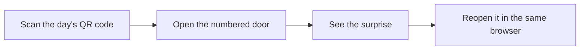
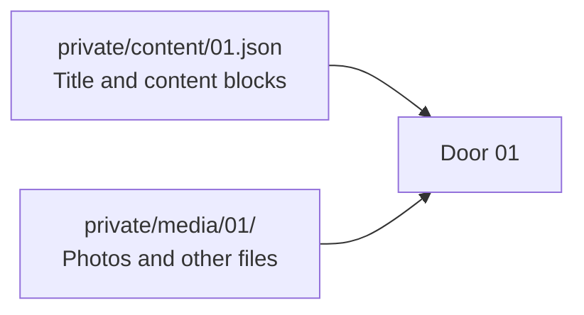

# Advent Calendar

A private Advent calendar for 24 physical surprises. Each chocolate can hide a QR code that opens a door in an illustrated winter house. Inside, share a note, photo, video, audio clip, voucher, quiz, file, or link.



## Run it locally

Requires **Node.js 24 or newer** and npm. From the repository root, copy `.env.example` to `.env` if you don't already have one. Then run:

```sh
npm ci
npm run db:init
npm run qr:generate
npm run dev
```

Visit `http://localhost:5173`. To test a door without a scan, paste its URL from `generated-private/qr-links.json` into your browser. The printable sheet is in `generated-private/printable/index.html`. For [phone testing over Wi-Fi](docs/operations.md#test-from-a-phone-on-your-local-network), use an address your phone can reach.

## Add a surprise



For Day 1, put `winter.jpg` in `private/media/01/` and add an image block to `private/content/01.json`:

```json
{
  "day": 1,
  "title": "A winter memory",
  "blocks": [{ "type": "image", "src": "winter.jpg" }]
}
```

Blocks appear in the order you list them. Use lowercase file extensions and put just the filename in `src`. Add an optional `alt` for a description and caption. Reopen the door to see your edits. [See examples for every block type](docs/operations.md#write-the-surprises).

## Deploy or update

| If you're…                         | Start here                                                                                                                           |
| ---------------------------------- | ------------------------------------------------------------------------------------------------------------------------------------ |
| Putting a new calendar online      | [Docker and HTTPS setup](docs/operations.md#ubuntu-docker-deployment)                                                                |
| Updating a running calendar        | [Update workflow](docs/operations.md#updating-an-existing-server-deployment)                                                         |
| Preparing the physical calendar    | [Print the QR codes](docs/operations.md#qr-generation-and-printing)                                                                  |
| Looking after an existing calendar | [Backup and restore](docs/operations.md#backup-and-restore) · [Troubleshooting](docs/operations.md#verification-and-troubleshooting) |

**Already printed your QR codes?** Keep the same public hostname, SQLite database, and credential vault. Keep the printed codes and secret URLs private. Each one grants access to its door.

The [operations guide](docs/operations.md) covers configuration, deployment, and recovery.
